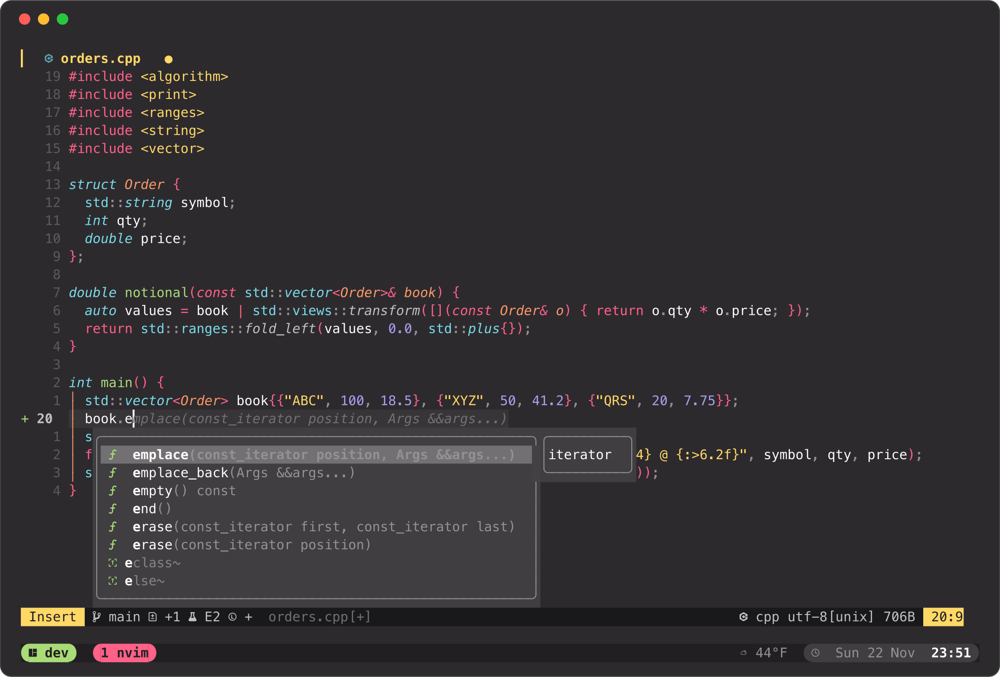
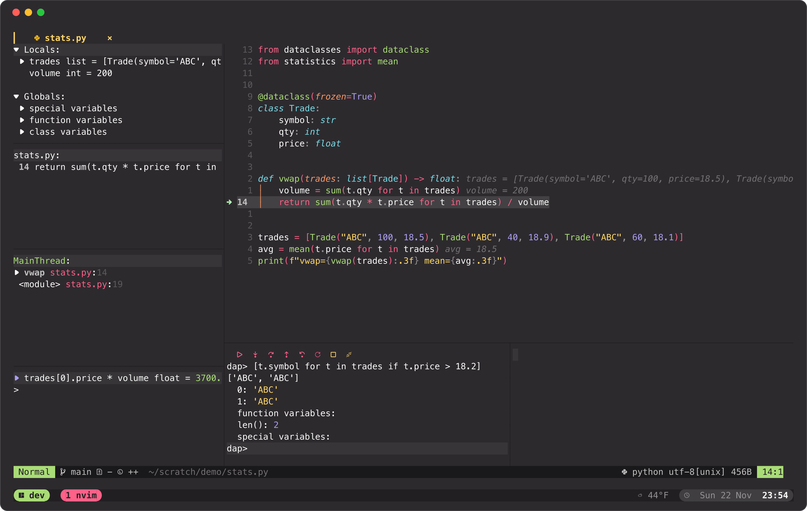
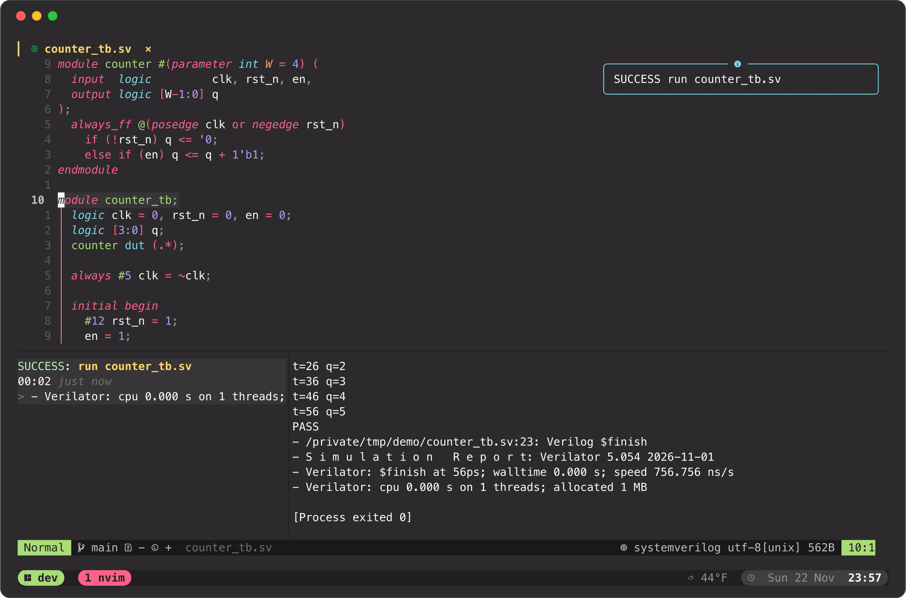
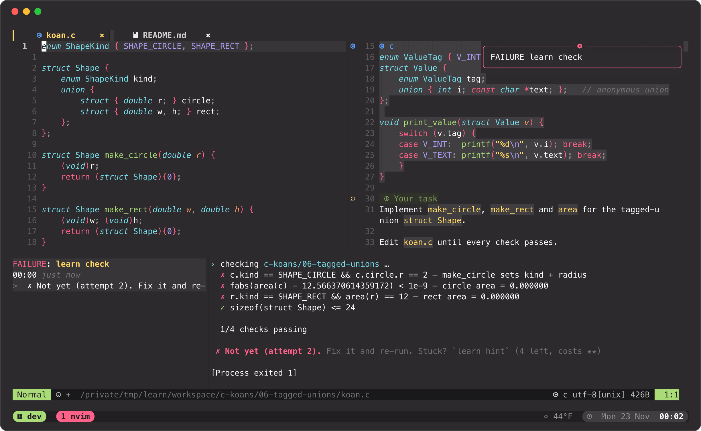
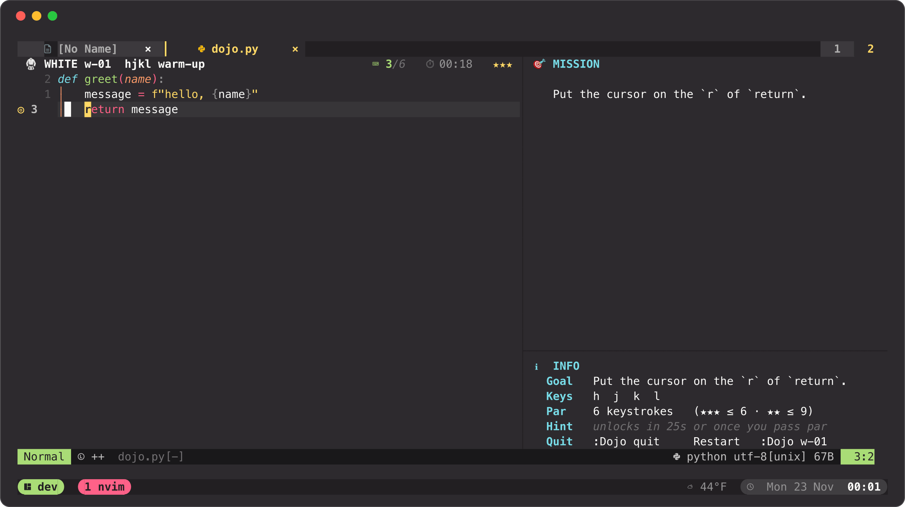
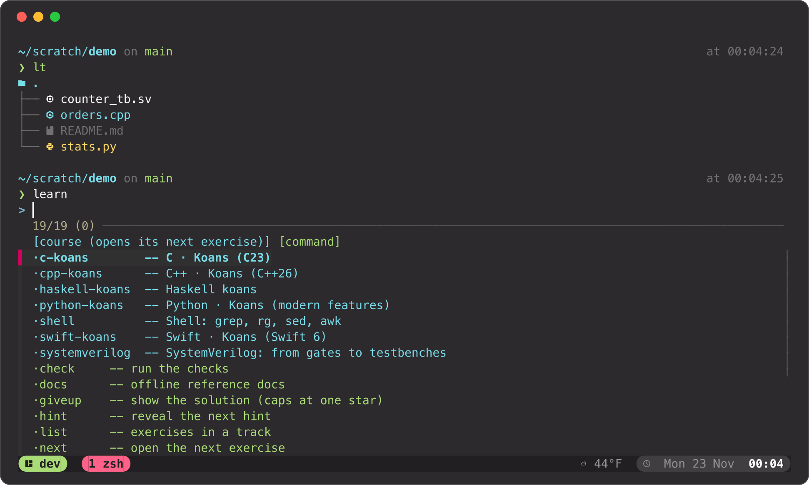
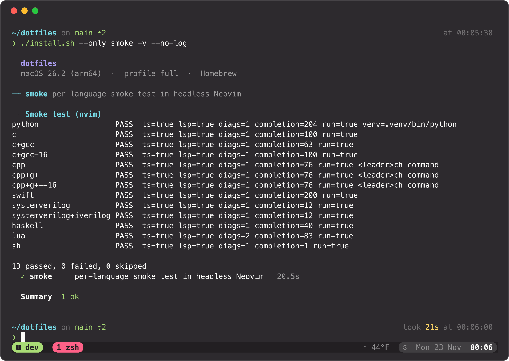

# dotfiles

A portable terminal development environment for macOS and Linux: a Neovim IDE for Python, C/C++, Rust, Swift, SystemVerilog and Haskell, tmux, zsh, kitty and Claude Code, plus offline trainers for getting better at all of it. Monokai Pro everywhere.



## Install

The latest release, on macOS or any Linux (Arch, Debian/Ubuntu, Fedora/RHEL, openSUSE, Alpine…), including SSH boxes without root:

```sh
bash -c "$(curl -fsSL https://github.com/samayc16/dotfiles/releases/latest/download/dotfiles)" - install
```

Or clone it to change it (updates then come from `git pull`):

```sh
git clone https://github.com/samayc16/dotfiles.git ~/dotfiles
cd ~/dotfiles && ./install.sh
```

Either way it installs everything, then smoke-tests every language in Neovim. Add flags after `install` or `./install.sh` to install less:

| profile | for |
|---|---|
| `./install.sh` (full) | your own machine: everything below |
| `./install.sh --profile dev` | no games or learning tracks |
| `./install.sh --profile cli` | minimal servers: shell, tmux, Neovim, CLI tools |

`./install.sh --list-steps` shows the plan; `--only <step>` re-runs one. Per-OS details, flags and no-root behaviour: [docs/install.md](docs/install.md).

**Updates.** When a new release is out, a new shell asks once: `dotfiles 2026.11.30 is available (you have 2026.11.24). Update now? [y/N]`. `dotfiles update` does it any time and `dotfiles rollback` goes back; neither touches files you've changed. `DOTFILES_NO_UPDATE_CHECK=1` in `~/.zshrc.local` turns the question off. Every push to main bumps the pinned versions of everything external (`pins.txt`), tests the whole install with them, and only then publishes a dated release. On Linux the tools are self-contained downloads (static wherever upstream builds one), so they don't depend on the distro; macOS uses Homebrew's current versions. Details: [docs/install.md](docs/install.md#updates-and-rollback).

## What you get

| area | highlights | guide |
|---|---|---|
| **Neovim** | LSP, completion, snippets, formatting, run (`Space rr`), debug and tests for 9 languages; Xcode build/run; SystemVerilog hierarchy + Verilator; Claude panel | [docs/neovim.md](docs/neovim.md) |
| **Learning** | `learn`: koans and Exercism exercises with tests, stars and XP · `:Dojo`: vim golf for motions and these keymaps · offline docs | [docs/learning.md](docs/learning.md) |
| **Music** | [plexamp-tui](https://github.com/samayc16/plexamp-tui) (`tamp`): Plex in the terminal. Play here, or follow and control Plexamp on your phone with synced lyrics; now playing in the tmux bar | [plexamp-tui](https://github.com/samayc16/plexamp-tui#readme) |
| **Games** | `play`: vim trainers, GameShell, a grep murder mystery, DOOM in Neovim, Zork, roguelikes | [docs/games.md](docs/games.md) |
| **Terminal** | zsh + Powerlevel10k with fuzzy Tab completion for everything, `tools` to see what's installed, tmux with popups, kitty, fzf/zoxide/eza/bat, lazygit + delta | [CHEATSHEET.md](CHEATSHEET.md) |
| **Claude Code** | Remote Control in every session, Claude inside Neovim (`Space ac`), a Tutor style for learning, `quiz` and `learn-coach` skills | [below](#claude-code) |

Every keybinding is in [CHEATSHEET.md](CHEATSHEET.md). In tmux press `prefix ?`; in Neovim press `Space` and wait.

<table>
  <tr>
    <td width="50%"><br>Debug any language: <code>Space db</code> sets a breakpoint, <code>Space dc</code> starts</td>
    <td width="50%"><br><code>Space rr</code> runs the file: here Verilator simulates a testbench</td>
  </tr>
  <tr>
    <td><br><code>learn</code>: fix the koan until <code>Space lc</code> passes</td>
    <td><br><code>:Dojo</code>: vim golf with par, stars and belts</td>
  </tr>
  <tr>
    <td><br>zsh: fuzzy <code>Tab</code> completion for every command</td>
    <td><br>The installer ends by proving every language works</td>
  </tr>
</table>

More screenshots in each guide: [Neovim](docs/neovim.md), [learning](docs/learning.md), [games](docs/games.md), [install](docs/install.md).

## First steps

1. Open a new kitty window (font) and run `tmux`.
2. `nvim .` → `-` to browse, `Space sf` to find a file, `Space rr` to run it.
3. `learn` → pick a track → `Space lc` checks your answer.
4. `:Dojo` for five minutes of vim practice.
5. `Space ac` to ask Claude about the code you're looking at.

## Claude Code

`claude/` is linked into `~/.claude/`.

- **Work vs learning:** task requests just get done; "how do I / teach me / why" gets taught. Inside `~/learn` the Tutor style is on: you answer first, hints come in levels, you write the key lines.
- **In Neovim:** `Space ac` opens Claude beside your code with your selection as context; edits arrive as diffs (`Space aa` accept, `Space ad` deny). `claude` in another tmux pane can attach with `/ide`.
- **Skills:** say "quiz me" for keymap / tmux / sed quizzes; ask for help on a `learn` exercise and get hints without spoilers.
- **Plugins:** language-server plugins for C/C++, Rust, Swift, Python and Lua (`claude/install-plugins.sh`, safe to re-run).

Tracked: `CLAUDE.md`, `output-styles/`, `skills/`, `rules/`, `agents/`, the status line and hooks, plus a starting `settings.json`. That one is *copied* to `~/.claude/settings.json` once, not linked, so whatever Claude saves there stays on your machine. It starts cautious (Claude asks before running commands); loosen your copy as you like. Credentials and `settings.local.json` are never tracked.

## Layout

```
install.sh · install.py · installer/ · install.d/   one installer, one script per step
pins.txt     every external version the installer uses (CI bumps it)   bin/dotfiles  update / rollback
nvim/        → ~/.config/nvim   lua/config, lua/plugins, lua/plugins/lang, scripts/{bootstrap,smoke}.lua
learn/       learn CLI tracks, roadmap, reading quests     games/  offline games installer
zshrc · zsh/ · tmux.conf · scripts/ · kitty/ · gitconfig · git/ · lazygit/ · clangd/ · mise/
bin/         → ~/bin (dotfiles, learn, play, copy)          claude/ → ~/.claude    codex/ → ~/.codex
docs/        guides       scripts/ → ~/.tmux/scripts        .github/workflows/  test + release pipeline
```

## Privacy

This repo is public and holds no secrets or personal details. Git identity lives in `~/.gitconfig.local` and machine-specific settings in `~/.zshrc.local`; neither is tracked.
