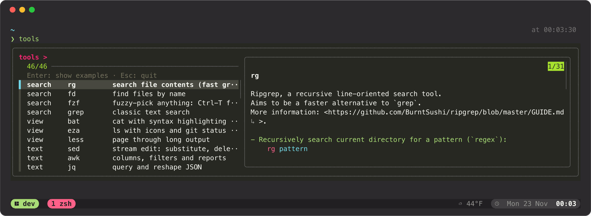

# shell (zsh)

## navigation
| keys | does |
|---|---|
| `cd <partial>` / `cdi` | zoxide-powered cd: real paths as usual, else jump to the best-ranked match / pick interactively (`z` / `zi` also work) |
| `1` … `5` | `cd ..`, `cd ../..`, … up N levels |
| `mkcd <dir>` | mkdir + cd |
| `Ctrl-T` | fzf **file picker** — insert path at cursor |
| `Ctrl-R` | atuin **history search**: every shell's history, fuzzy ([below](#history-files-processes-atuin-yazi-btop-direnv)) |
| `↑` / `↓` | history entries starting with what you've typed |
| `Alt-C` | fzf **cd** into a subdirectory |
| `Alt-Y` | copy current command line to clipboard via OSC52 (no execute; works over SSH/tmux) |
| `Shift-Tab` | accept autosuggestion |
| `Alt-←/→` or `Shift-←/→` | word back / forward (stops at `/` and `.`) |
| `Alt-Backspace` / `Alt-Delete` / `Shift-Backspace` | delete previous word |
| `Home` / `End` / `Delete` | work in every mode (normal, app, legacy sequences) |
| ` cmd` (leading space) | run without saving to history |

## discover what you have
| keys / cmd | does |
|---|---|
| `cheat <app>` · `cheat <words>` | one app's keys (`cheat tmux`, `cheat nvim`) · every key that mentions them, in any app (`cheat split`, `cheat tmux session`); `cheat` alone searches them all as you type |
| `Tab` | fuzzy completion menu for any command, flag, file, `learn` exercise or `play` game; type to filter, `<` / `>` switch groups |
| `rg --<Tab>` · `learn <Tab>` · `learn start <Tab>` | e.g. search every rg flag · every course · every exercise with its title |
| `r<Tab>` | commands starting with r, each previewed with its tldr examples |
| `tools` | every CLI tool installed here, grouped, with a live tldr preview (`tools rg` for one) |
| `tldr <cmd>` / `man <cmd>` | examples first / the full manual |

## listing (eza)
| cmd | does |
|---|---|
| `ls` | icons, dirs first |
| `ll` | long listing |
| `lrt` | long listing, newest last |
| `lt` | tree, 2 levels |

## aliases & functions
| cmd | does |
|---|---|
| `cat` | `bat --paging=never` |
| `vim` / `vi` | `nvim` |
| `lg` | lazygit |
| `rm` | `trash` (macOS) / `trash-put` (Linux) |
| `img <file>` | show image inline (kitty icat) |
| `c` | clear |
| `mux` | attach or create tmux session `main` |

## history, files, processes (atuin, yazi, btop, direnv)
| keys / cmd | does |
|---|---|
| `Ctrl-R` | atuin: search the history of every shell, fuzzy. `Enter` or `Tab` puts the command on the line, `Ctrl-R` again cycles the filter (global, host, session, directory, …), `Esc` leaves. Local only: no account, no sync |
| `atuin stats` · `atuin search <text>` | your most-used commands · search without the UI |
| `y [dir]` | yazi file manager; quit with `q` and the shell is in the directory you were in (`Q` quits without moving) |
| in yazi | `h j k l` move · `Enter` open · `Space` select · `y` `x` `p` copy / cut / paste · `d` trash (`D` delete) · `a` new (`name/` makes a dir) · `r` rename · `.` hidden files · `s` / `S` search names / contents · `z` fzf jump · `Z` zoxide jump · `~` help |
| `btop` | CPU, memory, disks, network and processes, graphed (`f` filter, `k` kill, `Esc` menu, `q` quit) |
| `direnv allow` | trust this directory's `.envrc`: its variables load when you `cd` in and unload when you leave (the prompt shows it) · `direnv edit .` · `direnv deny` |
| `ssh <host>` | in kitty (outside tmux) this is `kitten ssh`, which brings kitty's terminfo and shell integration along; plain `ssh` everywhere else |

Images preview in yazi inside tmux too (kitty graphics, passed through by tmux).

## scripts (`bin/` → `~/bin`)
| cmd | does |
|---|---|
| `cmd \| copy` | stream output **and** copy it (OSC52 locally, over SSH and in tmux; plus pbcopy / wl-copy / xclip when local) |
| `copy -n` | same, keep trailing newline |
| `copy_cmd echo hi` | copy the text `echo hi` without running it |
| `test_colors.sh` | 16 / 256 / truecolor + style test |
| `test_text_styles.sh` | bold / italic / underline test |

## secrets & machine-local config
`~/.zshrc.local` is sourced at the end if it exists and is **not tracked**. Put API keys and machine-specific paths there.
