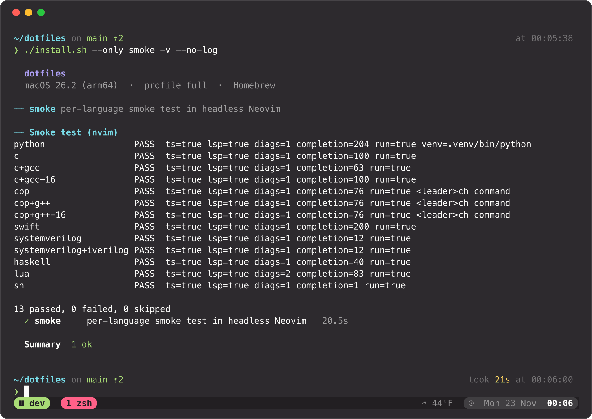

# Install details

Two ways in, both running the same installer:

```sh
# a release: unpacked to ~/.local/share/dotfiles/<version>/, no git needed
bash -c "$(curl -fsSL https://github.com/samayc16/dotfiles/releases/latest/download/dotfiles)" - install --profile cli
# a clone you can change
git clone https://github.com/samayc16/dotfiles.git ~/dotfiles && ~/dotfiles/install.sh
```

Offline or air-gapped: download `dotfiles.tar.gz` and `dotfiles` from the [latest release](https://github.com/samayc16/dotfiles/releases/latest), copy both over, then `bash dotfiles install --from dotfiles.tar.gz`. The tarball bundles the plexamp-tui wheel; everything else still comes from package managers.

`./install.sh` is a small POSIX shim: it finds Python 3.8+ (or fetches one) and runs `install.py`, which runs the steps in `install.d/` and prints a summary. Every step is idempotent and fail-soft; a log lands in `~/.cache/dotfiles/`.

The last step opens a sample file per language (and per installed compiler or simulator) in headless Neovim and checks highlighting, the language server, diagnostics, completion and `Space rr`:



## Flags

```sh
./install.sh --list-steps            # what would run on this machine, and why not
./install.sh --profile cli           # minimal box: shell, tmux, nvim, CLI tools
./install.sh --no-sudo               # never touch root; everything user-local in ~/.local
./install.sh --only nvim,smoke       # re-run some steps
./install.sh --skip games,learn      # everything except
./install.sh --with haskell          # add a step beyond the profile
./install.sh --without hdl-src       # never build Verilator/Icarus from source (last resort)
./install.sh --link-only             # just (re)create symlinks; existing files move to <file>.bak
./install.sh --dry-run -v            # print every command instead of running it
```

| profile | adds |
|---|---|
| `cli` | font, zsh + prompt, tmux, Neovim + plugins, CLI tools, Claude Code |
| `dev` | language servers, formatters, debuggers, parsers, Rust (rustup), HDL toolchain, smoke test |
| `full` (default) | Swift (Linux), Haskell, games, learning tracks, plexamp-tui (Plex music) + mpv |

## Where tools come from

| platform | source |
|---|---|
| macOS | Homebrew for everything |
| Linux with root/sudo | distro packages for the basics (compilers, zsh, tmux, Python, Verilator, Icarus, z3) |
| Linux, always | [mise](https://mise.jdx.dev) installs fast-moving tools user-locally: Neovim ≥ 0.12, tree-sitter, ripgrep, fd, fzf, bat, eza, delta, lazygit, zoxide, jq, gh, tmux, Node, uv (`mise/global.toml`) |
| Linux without root | zsh plugins cloned to `~/.local/share/zsh-plugins`; zsh built from source if missing; Swift via swiftly; Haskell via ghcup |
| Linux simulators | Verilator and Icarus Verilog from the distro if they work, else prebuilt conda-forge builds via mise (user-local, any glibc ≥ 2.17, recorded in `~/.config/mise/conf.d/hdl.toml`), else a source build. Each must simulate a test design to count. |
| no Python 3.8+ (RHEL 8, minimal containers) | the shim installs one, or fetches a standalone build with uv |

Fonts: Meslo Nerd Font (Homebrew cask on macOS, Nerd Fonts release + `fc-cache` on Linux; skipped on headless boxes, since the font matters where the terminal runs).

On corporate networks set `GITHUB_TOKEN` to avoid API rate limits; `HTTPS_PROXY` is honoured.

## Per-machine files (never tracked)

| file | holds |
|---|---|
| `~/.gitconfig.local` | git identity (created as a template on first install) |
| `~/.zshrc.local` | secrets, work-specific paths and aliases |
| `~/.claude/settings.local.json` | machine-specific Claude Code overrides |

## Updates and rollback

| | release install | git clone (`~/dotfiles`) |
|---|---|---|
| `dotfiles update` | downloads the newest release into its own `~/.local/share/dotfiles/<version>/`, runs its installer, then flips `~/.local/share/dotfiles/current` to it in one rename. If the installer fails, `current` stays where it was. | `git pull --ff-only`, then `./install.sh` again. With local changes, or a branch that has diverged from `origin/main`, it stops and tells you what to run; it never stashes, resets or forces. |
| `dotfiles rollback` | flips `current` back to the previous version (run it again to come forward). `rollback <version>` picks any of the last 3 kept on disk (`dotfiles list`). | `git checkout <tag>` (tags are the releases) |

Your home links point through `current` (a release) or straight into the clone, so switching versions changes every config at once and no file is copied over yours. The installer keeps the rule it always had: `link` moves anything that isn't its link aside to `<file>.bak`, and `seed` never replaces a settings file you already have (Claude Code and Codex settings are copies, never links). A release install also refuses to update while you have edited files inside the version itself (`dotfiles status` lists them; per-machine changes belong in `~/.zshrc.local` and friends), and never prunes a version you edited. `dotfiles update` re-runs the installer with the flags of your last full install; pass new ones to change them (`dotfiles update --profile dev`).

**The prompt.** An interactive shell on a terminal reads one cached file and, when a newer release is out, asks once per version:

```
dotfiles 2026.11.30 is available (you have 2026.11.24). Update now? [y/N]
```

`y` runs `dotfiles update`; `N` is remembered for that version. The cache is refreshed at most once a day by a background job (`dotfiles check`, a 5 s lookup of `releases/latest`) that stays silent on failure, so shell startup never waits for the network. It never asks in CI, in non-interactive shells, or over SSH without a terminal. Turn it off with `export DOTFILES_NO_UPDATE_CHECK=1` in `~/.zshrc.local`.

**Your own clone.** CI commits pin bumps to `main` after you push, so your clone falls one commit behind: `dotfiles update` pulls it. If you've committed meanwhile, `git pull --rebase` first (`dotfiles update` says so).

## Pins and releases

`pins.txt` lists every external version the installer uses, one per line (`name kind source version`): the plexamp-tui release, the 16 repos `learn/fetch.sh` clones (Exercism tracks, example projects, docs), and TPM with the 7 tmux plugins. Nothing installs "whatever is newest today": `learn/fetch.sh` and the `tmux` step clone at the pinned commit (and leave a clone you've changed alone), and the `music` step installs the pinned plexamp-tui wheel. Neovim plugins are pinned separately by `nvim/lazy-lock.json`, and the Linux CLI tools by `mise/global.toml`.

On every push to `main`, `.github/workflows/install.yml`:

1. **pins**: `scripts/bump-pins.py bump` moves each pin to the newest version (`git ls-remote <url> HEAD` for commits, GitHub's `releases/latest` for numbered releases) and builds the tarball a release would ship.
2. **tests**: installs from scratch with those pins (below).
3. **release**, only if every test passed: commits the tested `pins.txt` to `main` as `github-actions[bot]` (listing what moved and the run that tested it), tags `vYYYY.MM.DD` (`.1`, `.2` for more that day) and publishes a GitHub release with `dotfiles.tar.gz` (the repo at that commit, the pinned plexamp-tui wheel in `dist/`, `VERSION` and `VERSIONS.txt`) and the `dotfiles` script. `releases/latest/download/dotfiles.tar.gz` is always the newest.

Pull requests test the committed pins. `scripts/bump-pins.py bump` locally does what CI does; `diff OLD NEW` and `table` print changes and versions.

## CI

`.github/workflows/install.yml` installs on Ubuntu 24.04, Debian 12, Fedora, Rocky 9 and Arch, both as root from the checkout (`--profile dev --with music`, plus the learn fetch with offline docs on Ubuntu) and as a user without sudo from the release tarball (`dotfiles install --from … --profile cli --with hdl,music`), plus macOS: unit tests under bash 3.2, a dry run, links, the tmux plugins, and a release install, update and rollback. Every Linux job checks tool versions, symlinks (through `current` for the release install), a clean zsh start, `Lazy! restore`, every tmux plugin at its pin with TPM finding them all, `tamp --version` and `tamp status` (no mpv on the no-sudo leg), and a simulation in both Verilator and Icarus. Failed jobs upload Neovim's logs as an artifact.
