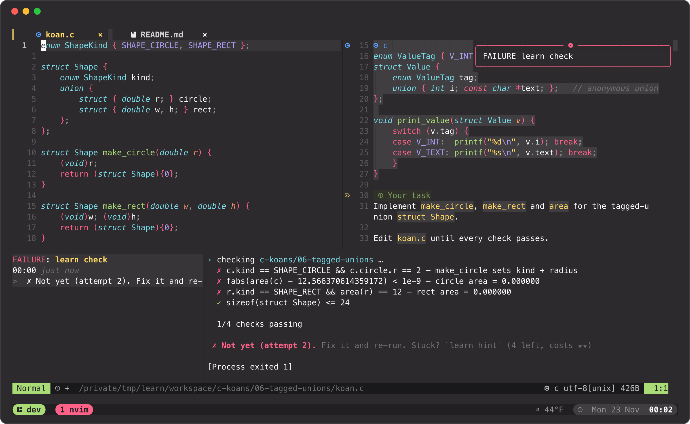
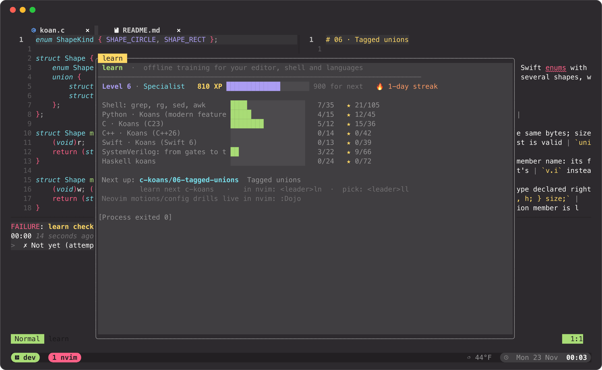
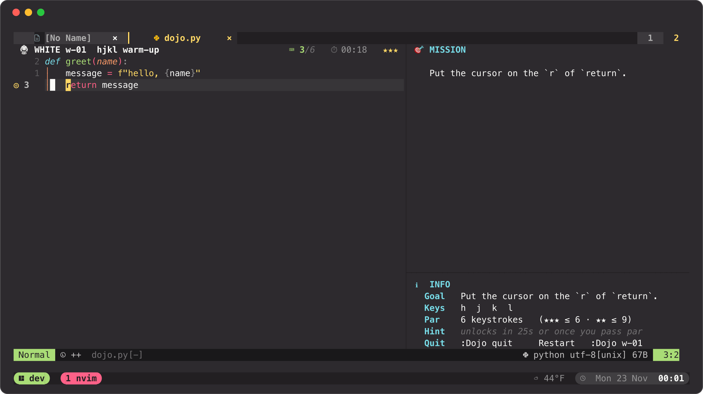

# Learning guide

Three trainers, all offline, all with scores so progress is visible.

| trainer | where | what you get better at |
|---|---|---|
| `learn` | terminal or `Space l` in nvim | languages and grep/rg/sed/awk: real exercises with tests, stars and XP |
| `:Dojo` | nvim | vim motions and *this* config's keys: golf challenges with par, belts and streaks |
| `play` | terminal (`:Games` in nvim) | everything else: vim-be-good, typing, GameShell, a grep murder mystery, games |



## Your first session

1. `learn`: see the dashboard. `learn <Tab>` lists every course.
2. `learn shell` (any course name): its next exercise opens in nvim with the task on the right.
3. Edit, then `Space lc` to check. Stuck? `Space lh` gives a hint (costs a star).
4. Pass it and `Space ln` opens the next one in the same nvim (`Space lp` goes back one).
5. Warm up or cool down with `:Dojo next`.

Stars: ★ pass · ★★ no hints · ★★★ also under par (shortest solution) or first try.

<p>
  
  
</p>

## Where to start

[learn/ROADMAP.md](../learn/ROADMAP.md) has a "start here" for every language. The short version:

| language | path |
|---|---|
| Haskell (from zero) | `haskell-koans`: 24 koans, expressions to monads, two boss levels |
| C | `c-koans` (C23: pointers, memory, ASan) → Exercism `c` |
| C++ | `cpp-koans` (C++26: move, smart pointers, ranges, concepts, `std::expected`) → Exercism `cpp` |
| Rust | `rust-koans` (17 koans from ownership to unsafe/FFI, written for C/C++ programmers; `Space ce` explains any compiler error) → Exercism `rust` |
| Swift | `swift-koans` → Exercism `swift` |
| SystemVerilog | `systemverilog`: gates → FSMs → FIFO → assertions → classes → UVM-style testbench |
| Python | `python-koans` (dataclasses, generators, typing, `match`) → Exercism `python` |
| Shell | `shell`: 35 levels of grep, rg, sed and awk |

Then read real code with the reading quests in [learn/projects/](../learn/projects/): small, well-written projects (kilo, chibicc, micrograd, picorv32…) with a checklist of things to find using `grd`, `grr` and `gO`.

## Before a flight

```sh
~/dotfiles/learn/fetch.sh     # exercises, projects, offline docs (~1 GB in ~/learn)
```

`learn docs cpp` (or `c`, `rust`, `python`, `haskell`, `swift`, `sv`) opens the offline reference; `learn docs rust` opens The Book, std and Rust by Example from rustup.

## Learning with Claude

Inside `~/learn`, Claude Code switches to a tutor style: it asks what you think, gives hints before answers, and has you write the key lines. Use `/output-style` to switch anywhere else.
