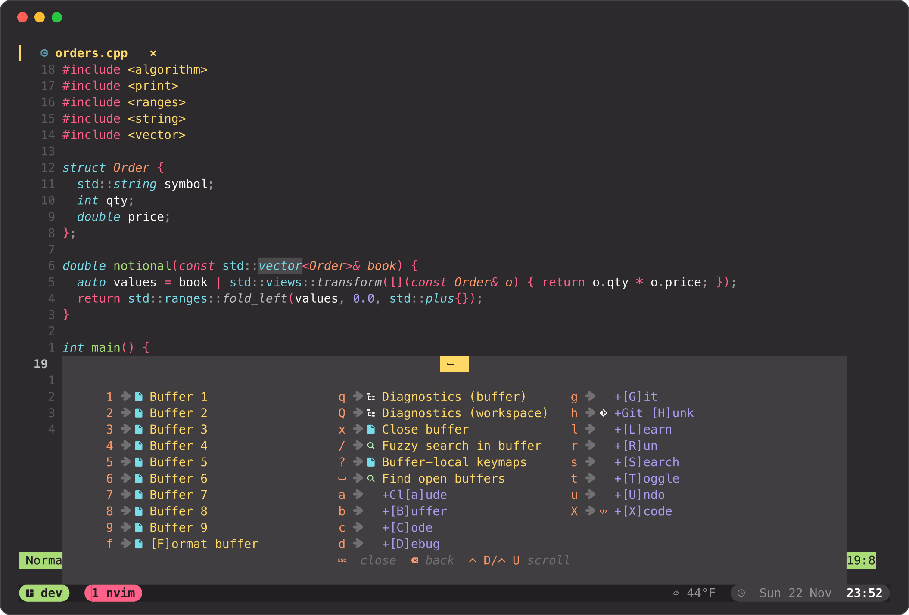
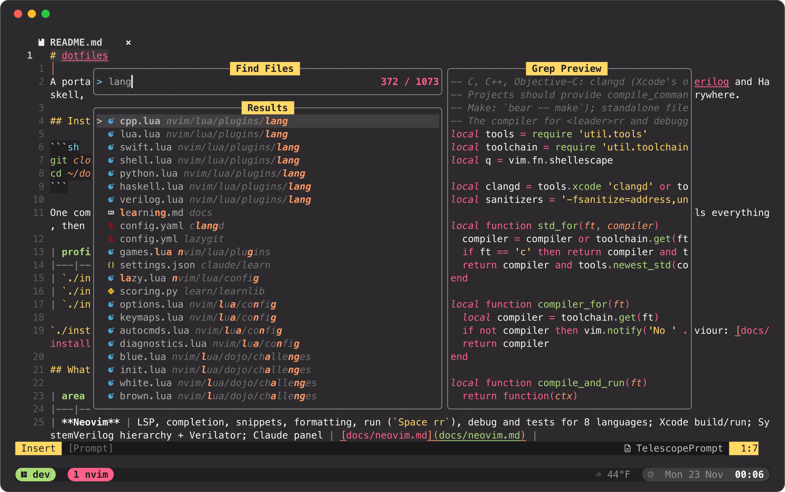
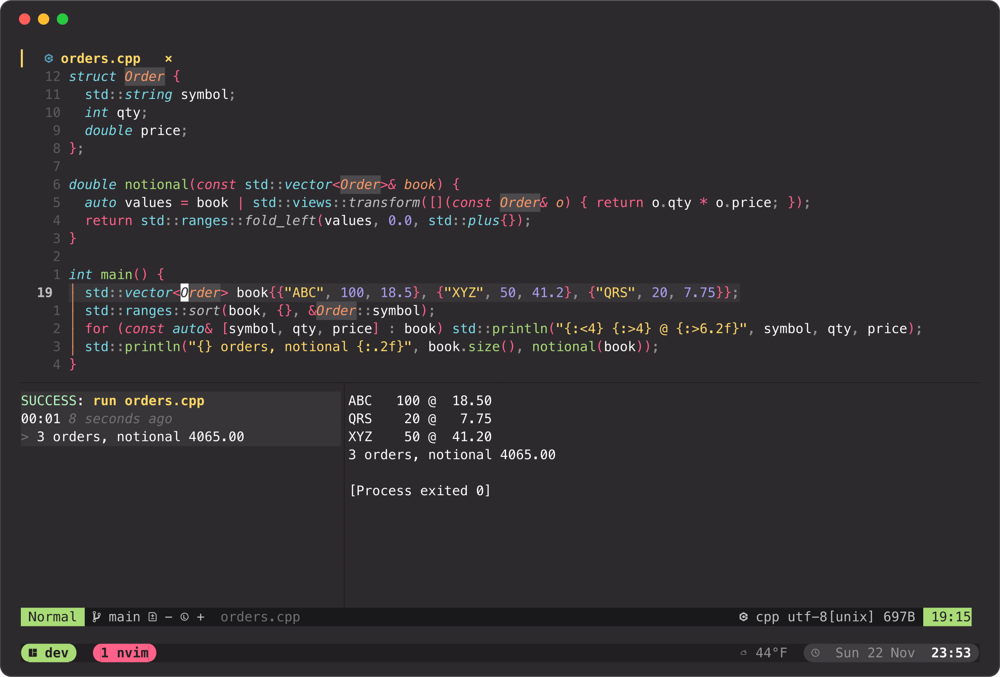
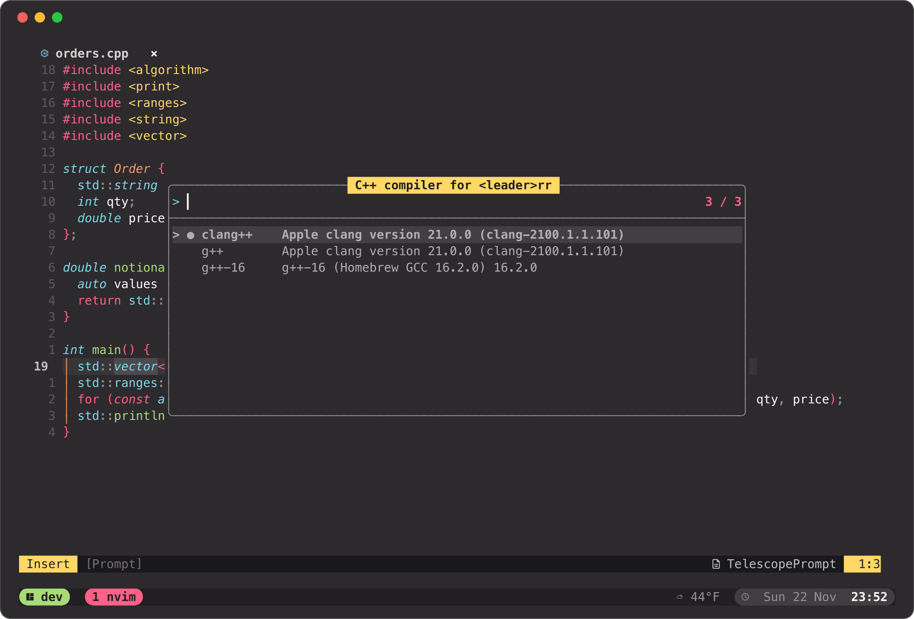
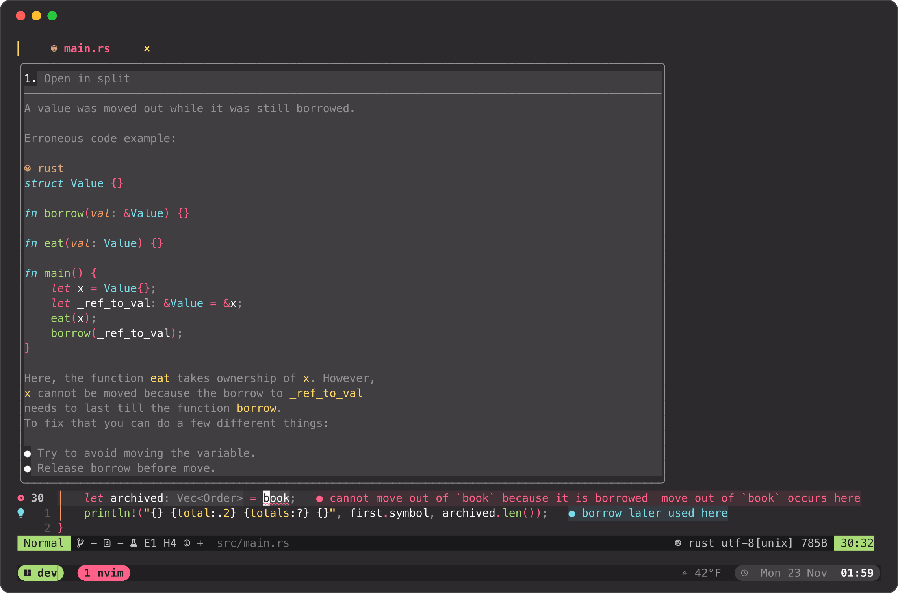
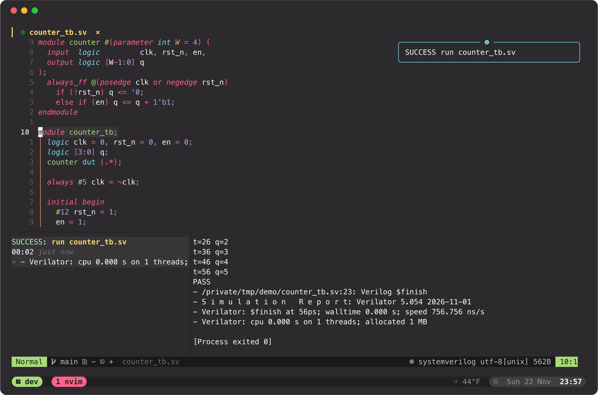
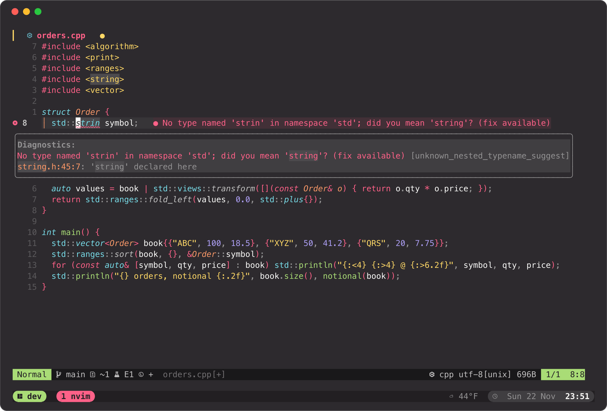
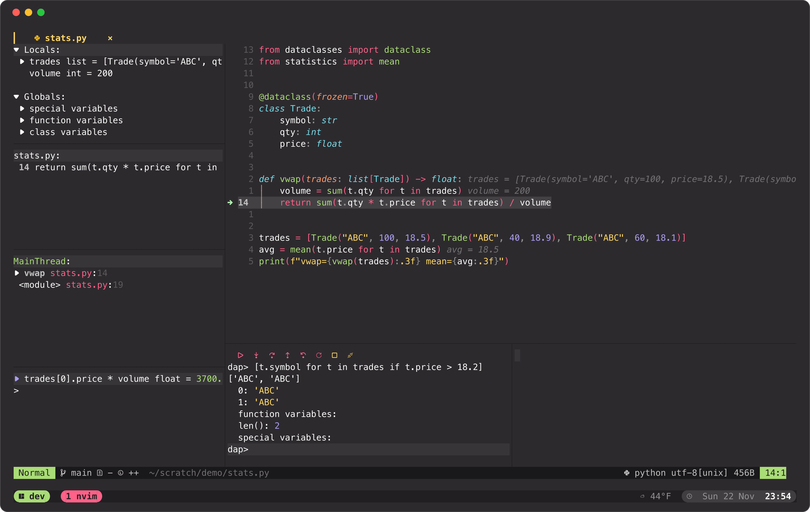

# Neovim guide

A full IDE for Python, C, C++, Rust, Swift, SystemVerilog/Verilog, Haskell, Lua and shell that works offline. Leader is `Space`.
Every key is in [cheatsheets/neovim.md](../cheatsheets/neovim.md) (`Space sC` inside Neovim); this guide covers how to *use* them.

## First 10 minutes

| do this | to learn |
|---|---|
| `nvim .` then `-` | browse files (oil): rename by editing the text, `:w` applies it |
| `Space` and wait | which-key lists every group: `s` search, `c` code, `r` run, `d` debug, `g` git… |
| `Space sf` / `Space sg` | find a file / grep the project |
| open a `.py` file, put the cursor on a name, `K` | hover docs from the language server |
| `grd` then `Ctrl-o` | jump to a definition and back |
| `Space rr` | run the file; output docks at the bottom |
| `Space rc` | choose the compiler or simulator `Space rr` uses (clang or gcc, Verilator or Icarus) |
| `Space db` then `Space dc` | set a breakpoint and start the debugger |
| `:Dojo` | practise all of the above as a game |

<p>
  
  
</p>

## Languages

Everything below is installed and smoke-tested by the installer.

| language | language server | runs with `Space rr` | notes |
|---|---|---|---|
| Python | basedpyright + ruff | project `.venv` python, else `python3` | `.venv` is picked up automatically; `Space ro` → pytest |
| C / C++ | clangd | clang, gcc or Homebrew's gcc-NN (`Space rc`), with ASan/UBSan where they work, newest standard the compiler accepts (C23 / C++26) | projects: generate `compile_commands.json` |
| Swift | sourcekit-lsp | `swift run` in packages, `swift file.swift` otherwise | Xcode apps: see below |
| SystemVerilog / Verilog | slang-server | Verilator or Icarus (`Space rc`), top = module named after the file | waves: `Space ro` → surfer |
| Haskell | haskell-language-server | `runghc` | `Space ro` → ghci |
| Rust | rust-analyzer (rustaceanvim) + clippy | `cargo run` in a Cargo project, else `rustc` | inlay hints on; `Space ro` → cargo build/test/clippy |
| Lua · shell | lua_ls · bashls + ShellCheck | `nvim -l` · bash | |

<p>
  
  
</p>

Format with `Space f`. Python, Lua, Haskell and Rust also format on save; C-family and Swift only when the project has a style file (`.clang-format`, `.swift-format`); shell and Verilog never automatically. `Space tf` toggles format-on-save.

### C and C++ projects
clangd needs the real compile flags. Give it a `compile_commands.json` in the project root:

```sh
cmake -B build -DCMAKE_EXPORT_COMPILE_COMMANDS=ON && ln -s build/compile_commands.json .
bear -- make          # Makefile projects
```

`Space ch` switches between header and source. Debug the current file with `Space dc` → "Debug current file" (builds it with `-g`).

### Xcode apps
Run `:XcodebuildSetup` once in the project root (pick scheme and simulator). After that sourcekit-lsp understands the `.xcodeproj`, and `Space X` has build, run, test, debug and SwiftUI previews. Keep Xcode for signing, asset catalogs and storyboards: `Space Xo` opens the project there.

### Rust projects
rust-analyzer comes from rustup, so it always matches your compiler. `Space ce` explains the error under the cursor (the `rustc --explain` text), `Space cm` expands a macro, `Space cD` opens docs.rs. `Space rn` / `Space dn` list the tests and binaries rust-analyzer found, to run or debug one. Clippy runs on every save; inferred types and elided lifetimes show inline (`Space th` toggles them). In `Cargo.toml`, crates.nvim marks outdated dependencies.



### SystemVerilog projects
slang-server reads `.slang/server.json` in the project root for include dirs, file lists and UVM paths ([docs](https://hudson-trading.github.io/slang-server/start/config/)). `Space vh` shows the elaborated hierarchy. Snippets cover RTL (`aff`, `fsm`, `intf`, `tb`, `assertp`) and UVM (`uvm_drv`, `uvm_env`, `uvm_test`…); type the prefix and accept.



## Everyday workflows

| task | keys |
|---|---|
| fix an error | `]d` to the next diagnostic, `Space ca` for a code action, `Space q` for the list |
| rename everywhere | `grn` |
| find callers | `grr` |
| outline of the file | `Space cs` or `gO` |
| build the project | `Space ro` (make, cmake, swift build, pytest, verilator lint…) |
| re-run the last thing | `Space rl` |
| stage part of a change | `]c` to a hunk, `Space hp` preview, `Space hs` stage |
| full git UI | `Space gg` (lazygit) |
| ask Claude about code | select it, `Space as` |

Completion accepts with `Ctrl-y`, `Tab` or `Enter`; `Ctrl-e` closes the menu.

<p>
  
  
</p>

## Keeping it healthy

| command | when |
|---|---|
| `:Lazy sync` | update plugins (then commit `nvim/lazy-lock.json`) |
| `:Mason` | inspect language servers and tools |
| `nvim --headless -c 'luafile ~/.config/nvim/scripts/smoke.lua'` | prove every language still works |
| `:checkhealth` | diagnose anything else |

## Adding a language

Create `nvim/lua/plugins/lang/<name>.lua`. Each file extends the shared specs:

```lua
return {
  { 'nvim-treesitter/nvim-treesitter', opts = { ensure_installed = { 'go' } } },
  { 'neovim/nvim-lspconfig', opts = { servers = { gopls = {} } } }, -- mason installs it
  { 'stevearc/conform.nvim', opts = { formatters_by_ft = { go = { 'gofmt' } } } },
  { 'stevearc/overseer.nvim', opts = { run = { go = function(ctx) return { cmd = 'go run ' .. ctx.file } end } } },
}
```
